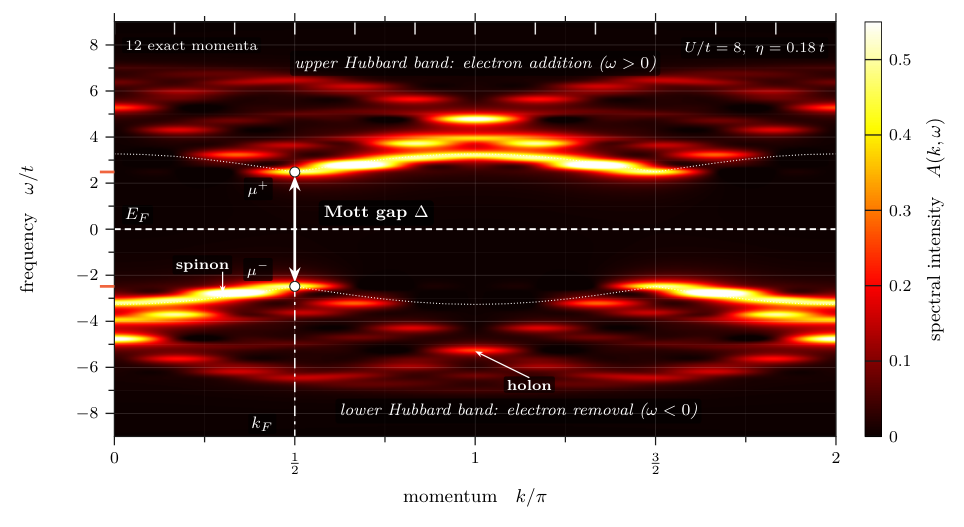
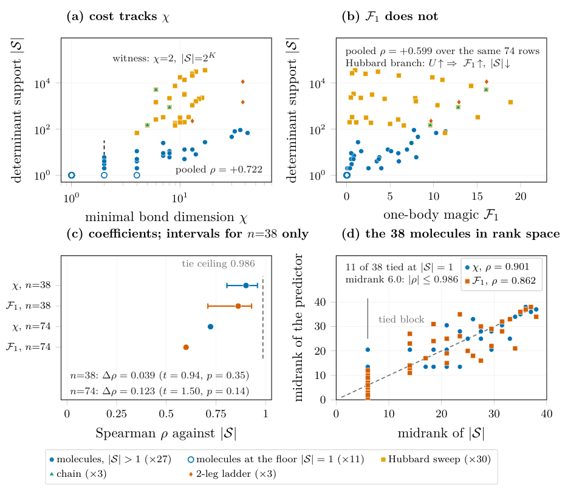
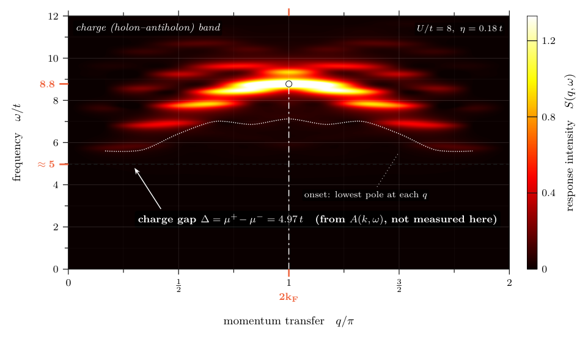
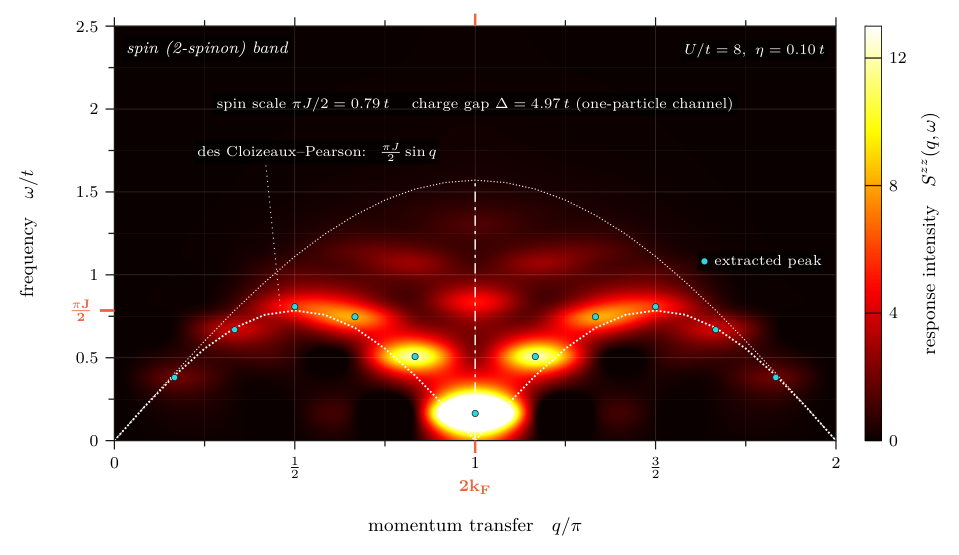
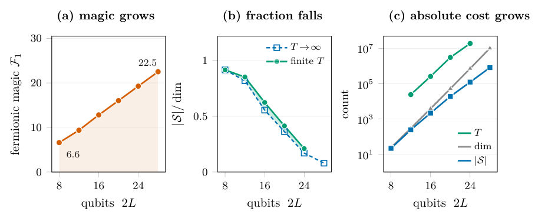
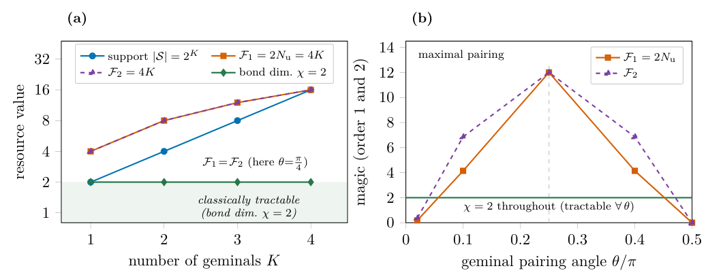

<div align="center">

# A two-sided error bound for spectral functions from sample-based quantum diagonalization

**Nicolás Bonilla Vargas** &nbsp;[](https://orcid.org/0009-0006-6155-4391)

[](CITATION.cff)
[](https://doi.org/10.5281/zenodo.22967220)
[](https://arxiv.org/abs/2608.16436)
[](paper/main_jcp.pdf)
[](paper/sm_jcp.pdf)
[](LICENSE)
[](LICENSE)
[](requirements.txt)

</div>

> **Versions.** Deposit **3.5.0** (this one) carries the manuscript prepared for *The Journal of Chemical Physics*
> and its Supplementary Material (`paper/main_jcp.pdf`, `paper/sm_jcp.pdf`). Deposit **3.4.1** (tag `v3.4.1`,
> Zenodo [10.5281/zenodo.23088494](https://doi.org/10.5281/zenodo.23088494)) carries the text posted as
> **arXiv:2608.16436v4**, whose Theorem 1 has only the first-order upper branch; its files are reachable through
> that tag and that record. The concept DOI [10.5281/zenodo.22967220](https://doi.org/10.5281/zenodo.22967220)
> always resolves to the latest version.

In sample-based quantum diagonalization and quantum-selected configuration interaction, Rayleigh–Ritz on sampled
determinants yields the spectral function of a probe, the ground state acted on by an operator. The manuscript proves
a **two-sided bound on that spectral function's error**: its relative `L₁` error on any subspace lies between `1−w`,
with `w` the probe's captured Born weight, and a bound set by `1−w` and the Hamiltonian coupling out of the subspace
at resolution `η`, computed from the Ritz pairs, the retained probe and one matrix–vector product per Ritz vector.
For a real probe (every local probe of the paper) the upper side is `min{1+w, (√(1−w) + Λ̂(η)/η)²}`, of second order
in the missed amplitude and the boundary coupling together; without that coupling the two sides coincide.

- **The coupling term is necessary.** An analytic counterexample forces any bound indexed on `w` alone to its
  trivial value, and on Hubbard rings (`L=6, 8`) the probe's determinant support (`w=1`) has relative error
  **0.35–0.43** at `η=0.18t`.
- **Where the bound is informative.** In classical Hubbard-ring simulations at five sizes up to a sector of
  **10 306 296** determinants, the bound falls below the trivial one at a nearly fixed true error,
  **2.6×10⁻³–1.5×10⁻²** over sixteen `(L,η)` cells at `L=6–12`, where it is 1.4×10²–7.8×10² times that error. A
  two-constant rule in `1−w`, fitted on some sizes and tested on the others, localizes this crossing more tightly on
  thirteen of fourteen splits; the certificate is a proven inequality, the rule a regularity of these systems.
- **Where it is not.** The infinite-shot Born-ranked subspaces reach a relative `L₁` error below 0.05 at smaller
  sector fractions, where the bound is no better than the trivial one: at every operating fraction of the resource
  scan the smaller of its two leakage branches exceeds the trivial bound by factors of **1.38–8.61**, so those
  reconstructions are uncertified. At `η=0.18t` the bound itself reaches 0.05 at `L=8` only between 0.90 and 0.92 of
  the sector.
- **Support.** In the determinant basis the coupling term vanishes at `w=1` for the local probes studied only when
  every symmetry-allowed determinant is kept (measured at `L=6–14`).
- **Scope.** Given the exact ground state, the bound is a certificate for benchmarking at exact-diagonalization
  scale; a convergence diagnostic must see the boundary coupling, not only the captured weight. Every system studied
  is classically tractable, and no quantum advantage is claimed.

**Companion works.** Review: *Machine learning for sample-based quantum diagonalization: a review of generative
configuration recovery and the classical-simulability frontier*, [arXiv:2608.05314](https://arxiv.org/abs/2608.05314).
Moment tests: *What low-order sum rules can and cannot detect in sample-based spectral functions*, reproduction
deposit [10.5281/zenodo.23374014](https://doi.org/10.5281/zenodo.23374014).

**Repository:** <https://github.com/nicolasbonilla/dynamical-spectral-functions-sqd> — the URL the manuscript's data
availability statement points to, also in [`CITATION.cff`](CITATION.cff).

This repository is the **reproduction record** of the manuscript: every figure and every printed number traces to a
script and a data file, except the gaps listed in [`docs/KNOWN_DISCREPANCIES.md`](docs/KNOWN_DISCREPANCIES.md), and
`python src/verify.py` recomputes the physics and checks the deposit against it. **It is not a claim that everything
re-runs here**: what a clean clone reaches — and the parts it does not, because they need `pyscf`, an IBM Quantum
account, or a figure step that is not deposited — is tabulated, measured, at the end of
[`docs/REPRODUCE.md`](docs/REPRODUCE.md). The data availability statement of the manuscript, and the audit behind each
of its sentences, are in [`docs/DATA_AVAILABILITY.md`](docs/DATA_AVAILABILITY.md).

---

## What is new in 3.5.0

- `paper/`: the manuscript prepared for JCP (`main_jcp.tex`, `sm_jcp.tex`; both run `main.tex`) and the two PDFs
  built from these sources. The arXiv-v4 PDF and its Physical Review A split are in `_superseded/arxiv_v4/`.
- Theorem 1 gains a second-order branch. Every printed number that depends on the upper branch was re-scored from the
  stored data, with no new run: `src/frontier/rescore_second_order.py` (arithmetic only, under a second) and
  `src/frontier/null_ws7_second_order.py` (the fitted-rule comparison on the re-scored crossings, a copy of
  `src/frontier/null_ws7.py`) write `data/c3_frontier/second_order/` (14 files; [`docs/C3_FRONTIER.md`](docs/C3_FRONTIER.md) §8).
- Fig. 1, the results figure, with its maker `src/make_fig_results_data.py`; the blue series of Fig. S10 on the new
  certificate, with its maker `src/make_fig_thmB_data.py`. Both are regenerated byte for byte by
  `src/check_figures.py`.
- The checks of the JCP package: `src/verify_jcp.py` (run by `src/verify.py` as its section 12; the registry of 706
  printed numbers with their stored sources is `src/jcp/number_sources.json`), and the JCP registrations merged into
  `src/check_coherence.py` and `src/check_trim.py`. Every change of a check is listed in
  [`docs/KNOWN_DISCREPANCIES.md`](docs/KNOWN_DISCREPANCIES.md) §36, with the change of the bound and every printed
  number that changed with it.

---

## Figure gallery

The thumbnails are those of deposit 3.4.1 (`docs/img/`); the figures are the same, numbered as in the manuscript
prepared for JCP. Fig. 1 of that manuscript, the results figure, is in `paper/main_jcp.pdf`.

| Momentum-resolved `A(k,ω)`, exact Mott map (Fig. S6) | The resource thesis (Fig. S3) |
|:---:|:---:|
|  |  |
| **Charge structure factor `S(q,ω)`, L=12 (Fig. S8)** | **Spin structure factor `S^zz(q,ω)`, L=12 (Fig. S9)** |
|  |  |
| **Scaling: fraction falls, absolute cost grows (Fig. S5)** | **The geminal witness (Fig. S1)** |
|  |  |

---

## Repository structure

```
.
├── src/                       # 69 computation & figure scripts, plus 31 in src/frontier/ (the C3 sweep and its re-scoring)
│   ├── verify.py              #   the adversarial guardian: recomputes the physics, then checks the deposit
│   ├── verify_jcp.py          #   the checks of the JCP text (section 12 of verify.py; also runnable alone)
│   ├── jcp/                   #   their registries: number_sources.json, trim_withdrawn_pass7.json, fracgrid_numbers.py
│   ├── check_figures.py       #   do the committed generators still produce the committed fragments?
│   ├── check_provenance.py    #   does the documentation still describe the manuscript? (derives it from main.tex)
│   ├── check_coherence.py     #   does the manuscript agree with itself?
│   ├── check_trim.py          #   did a cut remove a number or a limit? (needs the git history)
│   ├── make_*.py              #   figure generators, among them make_fig_results_data.py and make_fig_thmB_data.py
│   ├── frontier/              #   the C3 sweep; rescore_second_order.py and null_ws7_second_order.py (3.5.0)
│   └── recovered/             #   the generators of Figs. S7 and S10 and their compute (README inside)
├── data/                      # 43 JSON files at the top level, data/c3_frontier/ (110 files, of which 14 in
│                              #   second_order/), data/gflow_runs/ (20) and data/thm1iii_violation/
├── ckpt/                      # the L=14 ground-state checkpoint (94 MB) and ranking, with SHA-256 (ckpt/README.txt)
├── notebooks/                 # the v1-v2 narrated pipeline and the two IBM Heron notebooks (tokens scrubbed)
├── paper/                     # the manuscript prepared for JCP: REVTeX 4.2
│   ├── main.tex               #   preamble, abstract and the \input list of the main text and of the Supplement
│   ├── main_jcp.tex, sm_jcp.tex  # the two documents for JCP: main text with references, and the Supplement
│   ├── main_jcp.pdf, sm_jcp.pdf  # their builds (24 and 47 pages)
│   ├── sec_*.tex, sm_*.tex, app_*.tex, carried/, figs/   # the sections, the floats and the figure sources and data
│   └── arxiv-submission.tar.gz#   the FROZEN arXiv v2 bundle — a record, never a source
├── _superseded/               # earlier manuscripts and figures kept for the trail; arxiv_v4/ holds the 3.4.1 PDFs
├── docs/                      # REPRODUCE, FILE_INDEX, FIGURE_PROVENANCE, KNOWN_DISCREPANCIES, DATA_AVAILABILITY,
│                              #   C3_FRONTIER, ARXIV_SUBMISSION, and the two records of withdrawn text (JCP_*.md)
├── .github/workflows/ci.yml   # CI: `make verify`, `make check-figures` and `make check-coherence` on every push
├── Makefile                   # `make verify`, `make check-figures`, `make check-coherence`, `make paper`, `make ci`
├── CITATION.cff, .zenodo.json # citation and archive metadata
└── LICENSE                    # MIT (code) + CC BY 4.0 (manuscript, data and documentation)
```

---

## Quick start

```bash
python -m venv .venv && source .venv/bin/activate      # (Windows: .venv\Scripts\activate)
pip install -r requirements.txt

python src/verify.py            # the guardian (numpy/scipy only, about 10 s): recomputes, then checks; exit 0 = PASS
python src/check_figures.py     # the figure generators regenerate the committed tables and fragments
python src/check_provenance.py  # the documentation describes the manuscript in the tree
python src/check_coherence.py   # the manuscript agrees with itself
python src/check_trim.py        # no number or limit left the text (in a git clone: it reads the baseline commit)

# the re-scoring of the second-order branch, from the stored data (no simulation)
python src/frontier/rescore_second_order.py
python src/frontier/null_ws7_second_order.py > data/c3_frontier/second_order/null_ws7_second_order.txt

make paper                      # pdflatex main_jcp, sm_jcp (four rounds) -> paper/main_jcp.pdf, paper/sm_jcp.pdf
```

`[XFAIL]` lines of `verify.py` are registered open defects, printed on every run; they do not set the exit code.

**`paper/arxiv-submission.tar.gz` is the frozen snapshot of what was posted as arXiv v2 and must never be
re-uploaded**: 17 files in `paper/` have since moved ahead of it, 21 of its files no longer exist in `paper/`, and the
bundle still contains the two fabricated rows of `figs/sqw_edges.dat`. Run `python src/check_tarball.py` for the live
comparison ([`docs/KNOWN_DISCREPANCIES.md`](docs/KNOWN_DISCREPANCIES.md) §7).

---

## Reproducibility at a glance

*Measured 2026-11-18 on a clean copy of the tracked files (no `.git`); rows dated otherwise carry their date.*

| Layer | Reproducible here? | How |
|---|---|---|
| **The guardian** | ✅ **PASS** — 1269 checks, 0 failures, 16 565 numeric assertions, 4 xfail, 0 xpass, 2 skips; its section 12 runs the 21 checks of the JCP text | `python src/verify.py` (or `make verify`) |
| **The figure generators** | ✅ **PASS** — 23 artefacts from 11 generators, byte for byte (one provenance-timestamp comment line normalised, and the run says so) | `python src/check_figures.py` |
| **The documentation** | ✅ **PASS** — derived from `paper/main.tex`: 62 source files, 31 floats (17 figures, 14 tables) | `python src/check_provenance.py` |
| **Manuscript coherence** | ✅ **PASS** — 11 cross-section checks and 17 per-place checks, every control fires | `python src/check_coherence.py` |
| **No limit deleted** | ✅ **PASS** in a git clone (baseline commit `bc9670c`); it cannot run without the git history | `python src/check_trim.py` |
| **The re-scoring of the second-order branch** | ✅ reproduces `data/c3_frontier/second_order/` (every number equal; the run times recorded in two files differ) | `src/frontier/rescore_second_order.py`, `src/frontier/null_ws7_second_order.py` |
| **Exact diagonalization, numpy/scipy only** | ✅ verified locally on 2026-09-18/19, minutes per script | `docs/REPRODUCE.md` |
| **The 19-molecule suite** | ⚠️ needs `pyscf`; untested, so the molecular checks are transcription checks | `python src/n19_suite.py` etc. |
| **Figures** | ⚠️ 8 of 17 guarded by regeneration; the six PDF figures recompile from their deposited standalone sources but their three rasters cannot be regenerated here | [`docs/FIGURE_PROVENANCE.md`](docs/FIGURE_PROVENANCE.md) |
| **IBM Heron device runs** | ⚠️ need an IBM Quantum account and the jobs are closed; no raw counts are deposited; the manuscript states the two runs in one line of Sec. S12 | `notebooks/` |

---

## Security note

The hardware notebooks in `notebooks/` have had the author's IBM Quantum API token and instance CRN removed and
replaced with `<YOUR_IBM_QUANTUM_TOKEN>` / `<YOUR_IBM_QUANTUM_INSTANCE_CRN>` placeholders. To run them, insert your
own credentials (never commit them). This repository contains no secrets.

---

## Citation

If you use this work, please cite the manuscript and the deposit (see [`CITATION.cff`](CITATION.cff)):

```bibtex
@unpublished{BonillaVargas2026TwoSided,
  title  = {A two-sided error bound for spectral functions from sample-based quantum diagonalization},
  author = {Bonilla Vargas, Nicol\'as},
  note   = {Manuscript prepared for The Journal of Chemical Physics; an earlier version is arXiv:2608.16436},
  year   = {2026}
}

@software{BonillaVargas2026Repository,
  title     = {A two-sided error bound for spectral functions from sample-based quantum diagonalization ---
               reproduction repository},
  author    = {Bonilla Vargas, Nicol\'as},
  publisher = {Zenodo},
  version   = {3.5.0},
  doi       = {10.5281/zenodo.22967220},
  url       = {https://doi.org/10.5281/zenodo.22967220},
  year      = {2026}
}
```

## License

- **Code** (`*.py`, `notebooks/`, `Makefile`): [MIT](LICENSE).
- **Manuscript, figures, data and documentation** (`paper/`, `data/`, `docs/`): [CC BY 4.0](LICENSE).
